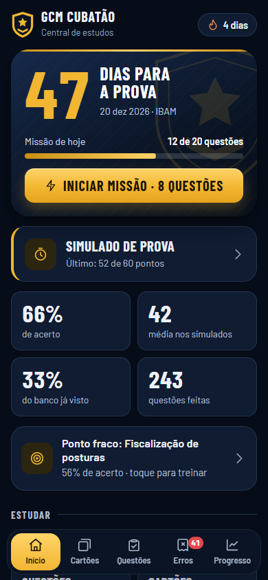
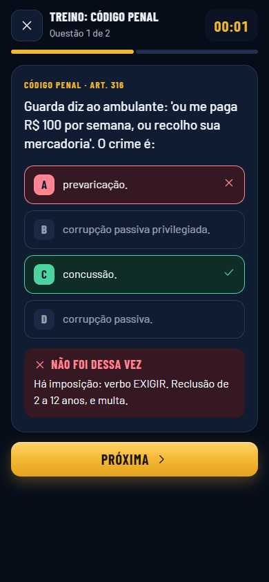
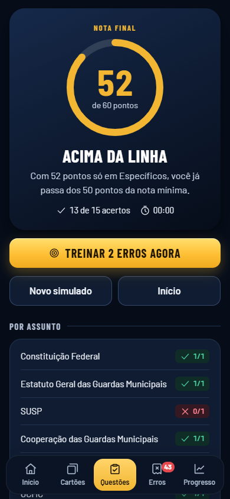
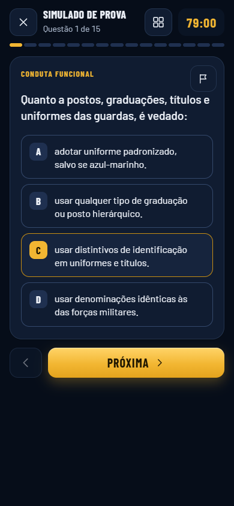
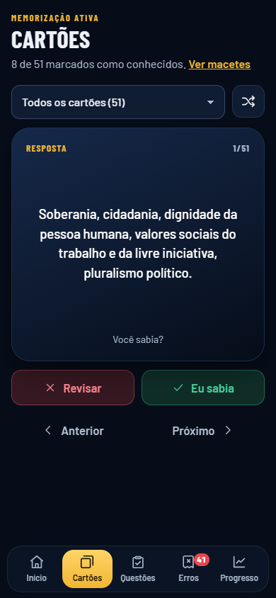
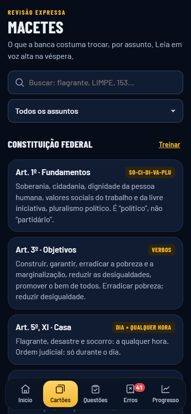
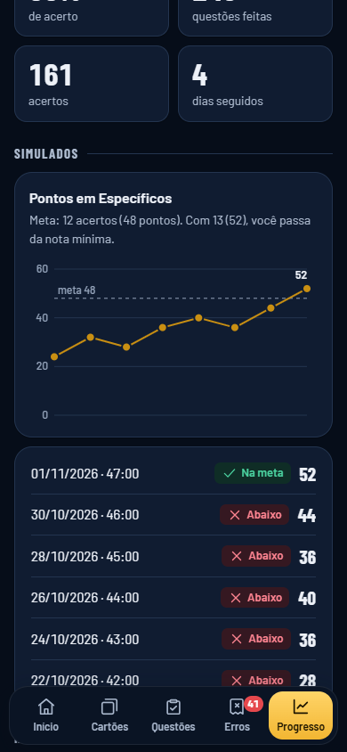
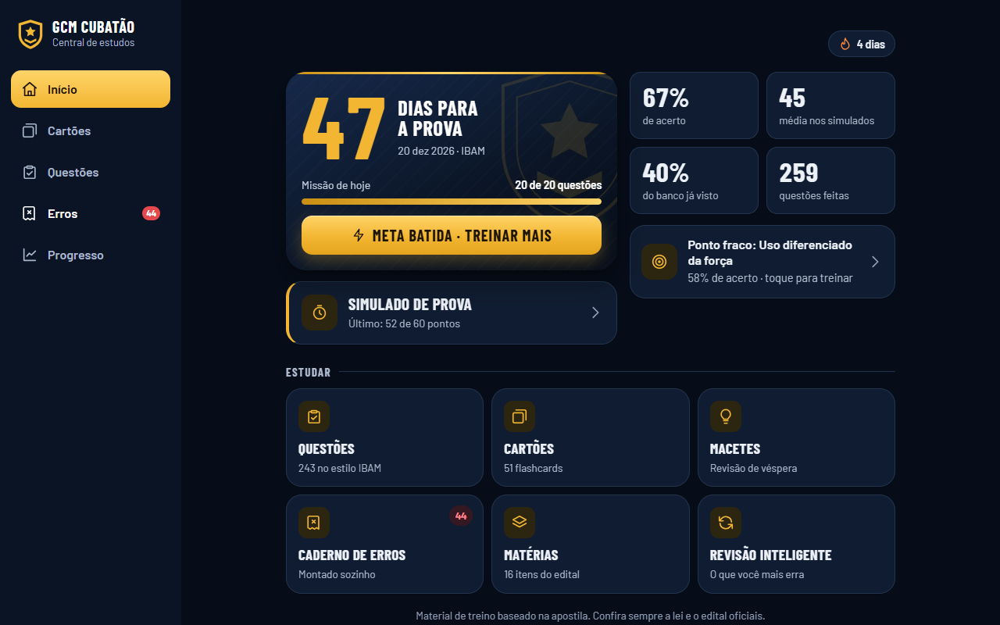
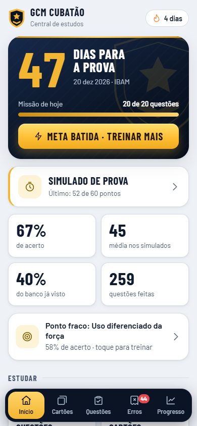
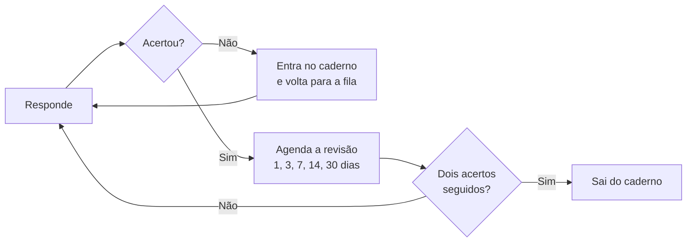

<div align="center">


# Central de Estudos · GCM Cubatão

**Um app simples, mas funcional, que fiz para estudar para o concurso da Guarda Civil Municipal de Cubatão.**

Abre no celular, funciona sem internet e não precisa de login, servidor nem banco de dados.

### [Abrir o app](https://nelsonmatheus.github.io/app-estudos-gcm-cubatao/)






</div>

## Por que este projeto existe

Fiz este app para o meu **estudo pessoal**. Eu queria treinar com o formato da prova no celular, a qualquer hora e sem depender de internet.

Ele cobre a parte que mais pesa na prova: **Conhecimentos Específicos, com 15 questões, peso 4 e 60 dos 100 pontos**.

Deixei o projeto aberto porque ele pode ajudar de duas formas:

- **Quem está estudando** para a GCM Cubatão ou para outras guardas municipais pode usá-lo como apoio, já que boa parte da legislação federal é comum.
- **Quem está aprendendo a programar** pode usá-lo como ideia de projeto: é um app completo, com lógica real, feito só com HTML, CSS e JavaScript.

> [!IMPORTANT]
> Este é um projeto pessoal, sem vínculo com a Prefeitura de Cubatão nem com o IBAM. As questões são material de treino e **podem conter erros**. Confira sempre a lei e o edital oficiais.

## O que ele faz

| | |
|---|---|
| **Início** | Contagem regressiva para a prova, missão diária, sequência de dias estudados e o seu ponto fraco |
| **Simulado** | 15 questões, 79 minutos e nota de 0 a 60, com gabarito só depois de entregar |
| **Treino** | Filtros por assunto, artigo, questões inéditas ou já erradas, com explicação logo após responder |
| **Caderno de erros** | Montado sozinho: o erro entra na hora e sai depois de dois acertos seguidos |
| **Revisão inteligente** | Escolhe o que você mais precisa rever |
| **Cartões** | Flashcards que giram em 3D, com filtro por assunto e lista do que revisar |
| **Macetes** | Revisão de véspera com busca: LIMPE, SO-CI-DI-VA-PLU, RE-FU-PE e outros |
| **Progresso** | Evolução nos simulados, dias estudados, acerto por assunto e backup |

<div align="center">






</div>

## As ideias mais criativas

**Sem chute pelo tamanho da alternativa.** Em muito banco de questões, a certa é a alternativa mais longa, e quem percebe acerta sem saber. Medi isso aqui, encontrei 75 questões em que a certa se destacava e reescrevi as erradas para ficarem parecidas. As alternativas também são embaralhadas a cada sessão.

**O simulado se comporta como a prova.** Dá para pular, voltar, trocar a resposta, marcar uma questão e usar o mapa de questões. O cronômetro continua correndo mesmo com o app fechado, e questão em branco conta como erro.

**A nota conversa com a regra do concurso.** O resultado não mostra só um número: com 13 acertos, por exemplo, ele avisa que os 52 pontos já passam da nota mínima de 50.

**Repetição espaçada sem backend.** Cada acerto seguido empurra a próxima revisão: 1, 3, 7, 14 e 30 dias. A revisão inteligente dá uma pontuação a cada questão:

```js
// Erros pesam mais, o último erro pesa ainda mais e questões vencidas sobem na fila
h.w * 3 + (h.l === 0 ? 5 : 0) + (h.due <= now ? 2 : 0) - h.r + Math.random();
```

**Graduação de estudo.** Cada acerto ou cartão conhecido vale um ponto, e você sobe de Recruta até Inspetor, com divisas na tela.

**Visual de insígnia.** Azul-marinho de farda, dourado de distintivo e fonte condensada de uniforme. O escudo e os ícones são desenhados em SVG, sem biblioteca, e os temas claro e escuro são pensados em separado.

<div align="center">




</div>

### Como uma questão circula pelo app



## Stack

| Camada | O que usei |
|---|---|
| **Estrutura** | HTML5 semântico, com `<dialog>` nativo para as janelas |
| **Estilo** | CSS puro: variáveis, Grid, Flexbox, `clamp()`, transformações 3D e tema automático ou manual |
| **Lógica** | JavaScript puro, sem framework e sem etapa de build |
| **Roteamento** | Hash na URL (`#quiz`, `#cards`), com botão voltar e links diretos funcionando |
| **Dados** | `localStorage`: o progresso fica só no aparelho, com backup em arquivo JSON |
| **Offline** | PWA com Service Worker, Cache API e Web App Manifest |
| **Gráficos e ícones** | SVG feito à mão, sem biblioteca de gráficos |
| **Fontes** | Barlow e Barlow Condensed, hospedadas no próprio projeto para funcionar sem internet |
| **Hospedagem** | GitHub Pages |
| **Desenvolvimento** | [Claude Code](https://claude.com/claude-code) como parceiro de programação e design |
| **Testes** | Roteiros em navegador headless (Chromium), rodados durante o desenvolvimento, nos tamanhos 320, 390 e 1280 px |

**Pequenos cuidados que fazem diferença:** navegação por teclado (`A` a `D` ou `1` a `4` para responder), respeito à opção de reduzir movimento do sistema, botões grandes para o toque e nada de rastreamento: nenhum dado sai do seu aparelho.

## Instalar no celular

1. Abra o [link do app](https://nelsonmatheus.github.io/app-estudos-gcm-cubatao/).
2. **iPhone:** no Safari, toque em Compartilhar e depois em Adicionar à Tela de Início.
3. **Android:** no Chrome, abra o menu e toque em Instalar app.

Depois de aberto uma vez, ele funciona sem internet.

> [!NOTE]
> O progresso fica só naquele navegador. Use **Progresso → Ajustes → Exportar** para guardar um backup.

## Rodar no seu computador

Não há nada para instalar além de um servidor local, necessário para o Service Worker funcionar.

```bash
git clone https://github.com/nelsonmatheus/app-estudos-gcm-cubatao.git
cd app-estudos-gcm-cubatao
python -m http.server 8000
```

Depois, abra `http://localhost:8000`.

## Usar como ideia de projeto

A estrutura serve para qualquer concurso ou matéria. Para adaptar:

1. **Assuntos e cartões:** edite `TOPICS` e `CARDS` em `data.js`.
2. **Questões:** crie um arquivo como o `bank-3.js`. A primeira alternativa é sempre a correta, porque o app embaralha na hora:

   ```js
   // [assunto, artigo, enunciado, [CORRETA, errada, errada, errada], explicação]
   [0, "Art. 37", "NÃO é princípio expresso no caput do art. 37:",
     ["razoabilidade.", "impessoalidade.", "publicidade.", "eficiência."],
     "LIMPE: legalidade, impessoalidade, moralidade, publicidade, eficiência."]
   ```

3. **Prova:** ajuste a data, o número de questões, o tempo e o peso no início de `app.js`, e o texto da data em `renderHome`.
4. **Publicação:** carregue o arquivo novo no `index.html`, antes do `extras.js`. Depois, liste-o em `sw.js` e suba a versão de `CACHE`, senão quem já instalou continua vendo a versão antiga.

**Desafios para treinar:** criar um modo de questões por áudio, sincronizar o progresso entre aparelhos, adicionar notificações de revisão ou incluir as outras matérias da prova.

### Organização dos arquivos

```text
├── index.html            Estrutura da página e ícones em SVG
├── styles.css            Sistema visual e temas
├── app.js                Telas, simulado, revisão e progresso
├── data.js               Assuntos, cartões e questões da primeira versão
├── bank-1, 2 e 3.js      Banco de questões
├── extras.js             Cartões adicionais e macetes
├── sw.js                 Funcionamento offline
├── manifest.webmanifest  Instalação como app
├── fonts/                Fontes locais
└── docs/screens/         Capturas de tela deste README
```

## Créditos e limitações

- **Conteúdo:** as questões e os macetes foram escritos com base na apostila *Resumão GCM Cubatão 2026*, de Felipe Resumão (@feliperesumao). Ela é o material de estudo completo; este app é só um apoio para treinar.
- **Fontes:** [Barlow](https://fonts.google.com/specimen/Barlow), de Jeremy Tribby, sob licença SIL Open Font.
- **Cobertura:** o app trata só de Conhecimentos Específicos. Português, Matemática e Informática ficaram de fora.
- **Testes:** rodei os testes no Chromium e ainda não em um iPhone real.
- **Legislação:** o conteúdo reflete o que a apostila trazia sobre as normas vigentes na data do edital e pode ficar desatualizado.

## Licença

- **Código** (`index.html`, `styles.css`, `app.js`, `sw.js` e `manifest.webmanifest`): [licença MIT](LICENSE). Pode usar e adaptar à vontade.
- **Questões, cartões e macetes** (`data.js`, `bank-*.js` e `extras.js`): não entram na licença MIT, porque foram escritos com base na apostila. Para reaproveitar o projeto, troque esse conteúdo pelo seu.
- **Fontes:** licença SIL Open Font.

<div align="center">

Feito para estudar, e compartilhado caso ajude mais alguém. Bons estudos e boa prova!

</div>
