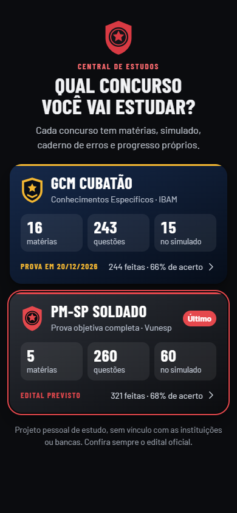
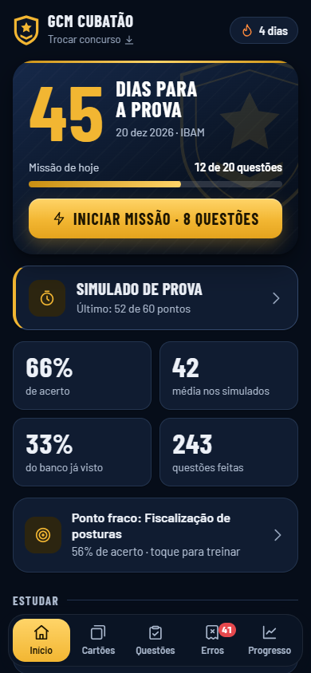
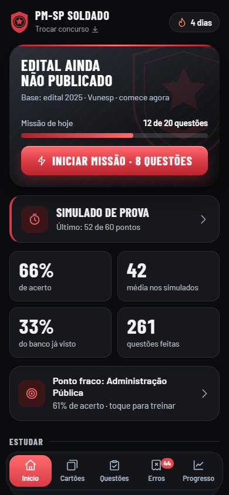
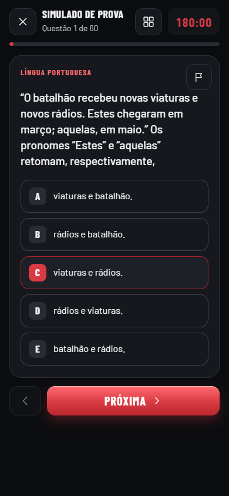
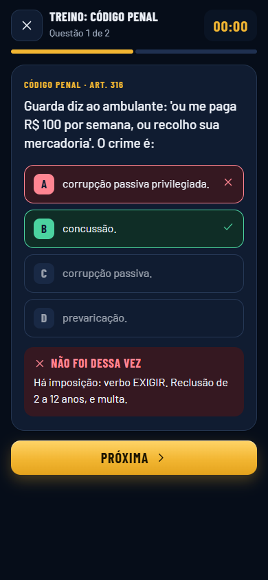
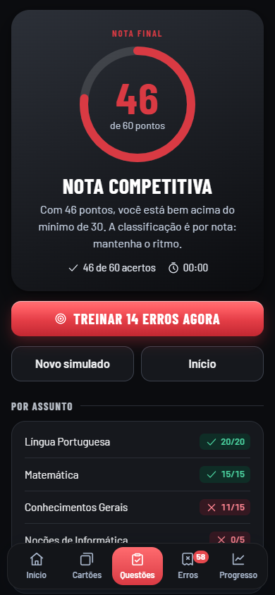
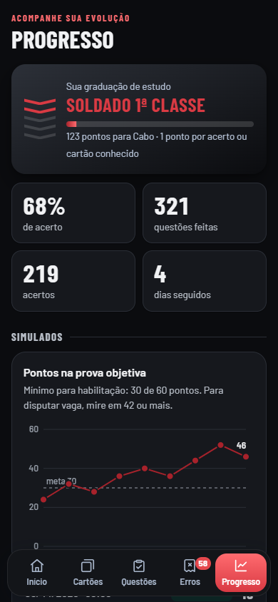
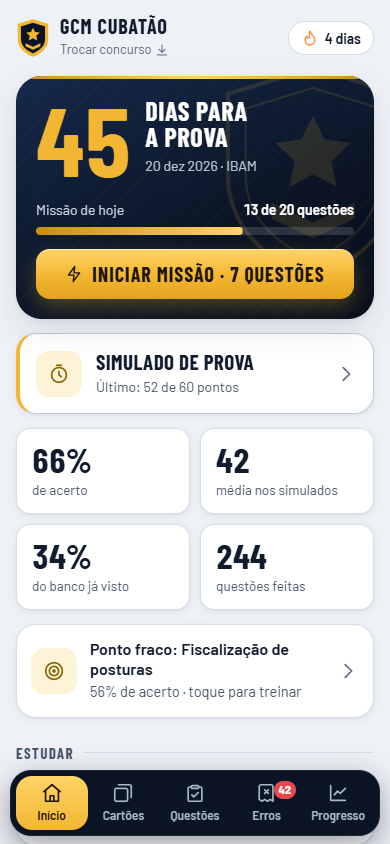
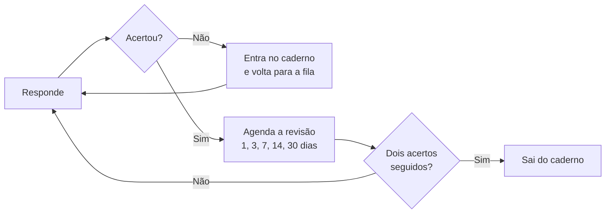

<div align="center">


# Central de Estudos · Concursos

**Um app para treinar para concursos de segurança pública no celular, com simulado, caderno de erros e revisão inteligente.**

Hoje cobre a **GCM Cubatão** e a **PM-SP Soldado**. Funciona sem internet e não precisa de login, servidor nem banco de dados.

### [Abrir o app](https://nelsonmatheus.github.io/central-de-estudos-concursos/)






</div>

## Por que este projeto existe

Comecei este app para o meu **estudo pessoal**: queria treinar no formato da prova, pelo celular, a qualquer hora e sem depender de internet. Ele nasceu para um único concurso. Quando surgiu um segundo, transformei a base em uma central que recebe vários.

Deixei o projeto aberto porque ele pode ajudar de duas formas:

- **Quem está estudando** pode usá-lo como apoio, principalmente para a GCM Cubatão, a PM-SP ou outras carreiras com legislação parecida.
- **Quem está aprendendo a programar** pode usá-lo como ideia de projeto: é um app completo, com lógica real, feito só com HTML, CSS e JavaScript.

> [!IMPORTANT]
> Este é um projeto pessoal, sem vínculo com a Prefeitura de Cubatão, a Polícia Militar de São Paulo, o IBAM ou a Vunesp. As questões são material de treino e **podem conter erros**. Confira sempre a lei e o edital oficiais.

## Concursos disponíveis

| | GCM Cubatão | PM-SP Soldado |
|---|---|---|
| **Banca** | IBAM | Vunesp |
| **Situação** | Prova em 20/12/2026 | Provisório: usa o edital de 2025 até sair o novo |
| **Conteúdo** | Conhecimentos Específicos (16 itens do edital) | Português, Matemática, Conhecimentos Gerais, Informática e Administração Pública |
| **Simulado** | 15 questões, 4 alternativas, 79 min | 60 questões, 5 alternativas, 3 h (tempo estimado) |
| **Nota** | 4 pontos por questão, até 60 | 1 ponto por questão, até 60 |
| **Questões** | 243 | 260 |
| **Cartões** | 51 | 73 |
| **Macetes** | 53 | 56 |

Na GCM Cubatão, o app cobre só a parte que mais pesa na prova, 60 dos 100 pontos. Na PM-SP, cobre a prova objetiva; a dissertativa fica de fora.

## O que dá para fazer

| | |
|---|---|
| **Escolher o concurso** | Cada um tem matérias, simulado, caderno de erros e progresso próprios, e dá para trocar quando quiser |
| **Foco de estudo** | Estude todas as matérias juntas ou só as que marcar, inclusive em um simulado só do foco |
| **Simulado** | Cronômetro, nota final e gabarito só depois de entregar |
| **Treino** | Filtros por matéria, tema, questões inéditas ou já erradas, com explicação logo após responder |
| **Caderno de erros** | Montado sozinho: o erro entra na hora e sai depois de dois acertos seguidos |
| **Revisão inteligente** | Escolhe o que você mais precisa rever |
| **Cartões** | Flashcards que giram em 3D, com filtro por matéria e lista do que revisar |
| **Macetes** | Revisão de véspera com busca: LIMPE, SO-CI-DI-VA-PLU, RE-FU-PE e outros |
| **Progresso** | Evolução nos simulados, dias estudados, acerto por matéria e backup |

<div align="center">






</div>

<div align="center">




</div>

## As ideias mais criativas

**Um motor, vários concursos.** O código do app não sabe qual é a prova. Cada concurso é um pacote em `concursos.js`, com matérias, banco de questões, regras e tema, e entrar um novo é questão de cadastrar mais um item.

**Cada concurso tem identidade própria.** A GCM usa azul-marinho e dourado, e a PM-SP usa grafite e vermelho. A graduação de estudo também acompanha a carreira: de Recruta a Inspetor em uma, de Recruta a Aspirante a oficial na outra.

**O simulado se comporta como a prova.** Dá para pular, voltar, trocar a resposta, marcar uma questão e usar o mapa de questões. O cronômetro continua correndo mesmo com o app fechado, e questão em branco conta como erro. Na PM-SP, o simulado segue a proporção do edital: 20 de Português, 15 de Matemática, 15 de Conhecimentos Gerais, 5 de Informática e 5 de Administração Pública.

**A nota conversa com a regra do concurso.** O resultado não mostra só um número. Na GCM, 13 acertos rendem 52 pontos e o app avisa que isso já passa da nota mínima de 50. Na PM-SP, ele diferencia quem ficou abaixo do mínimo de 30, quem se habilitou e quem chegou a uma nota competitiva.

**Sem chute pelo tamanho da alternativa.** Em muito banco de questões, a certa é a alternativa mais longa, e quem percebe acerta sem saber. Medi isso no banco da GCM, encontrei 75 questões em que a certa se destacava e reescrevi as erradas para ficarem parecidas. As alternativas também são embaralhadas a cada sessão.

**Repetição espaçada sem backend.** Cada acerto seguido empurra a próxima revisão: 1, 3, 7, 14 e 30 dias. A revisão inteligente dá uma pontuação a cada questão:

```js
// Erros pesam mais, o último erro pesa ainda mais e questões vencidas sobem na fila
h.w * 3 + (h.l === 0 ? 5 : 0) + (h.due <= now ? 2 : 0) - h.r + Math.random();
```

<div align="center">


</div>

### Como uma questão circula pelo app



## Stack

| Camada | O que usei |
|---|---|
| **Estrutura** | HTML5 semântico, com `<dialog>` nativo para as janelas |
| **Estilo** | CSS puro: variáveis, Grid, Flexbox, `clamp()`, transformações 3D, tema por concurso e modo claro ou escuro |
| **Lógica** | JavaScript puro, sem framework e sem etapa de build |
| **Roteamento** | Hash na URL (`#quiz`, `#cards`), com botão voltar e links diretos funcionando |
| **Dados** | `localStorage`: o progresso fica só no aparelho, separado por concurso, com backup em arquivo JSON |
| **Offline** | PWA com Service Worker, Cache API e Web App Manifest |
| **Gráficos e ícones** | SVG feito à mão, sem biblioteca de gráficos |
| **Fontes** | Barlow e Barlow Condensed, hospedadas no próprio projeto para funcionar sem internet |
| **Hospedagem** | GitHub Pages |
| **Desenvolvimento** | [Claude Code](https://claude.com/claude-code) como parceiro de programação e design |
| **Testes** | Roteiros em navegador headless (Chromium), rodados durante o desenvolvimento |

**Pequenos cuidados que fazem diferença:** navegação por teclado (`A` a `E` ou `1` a `5` para responder), respeito à opção de reduzir movimento do sistema, botões grandes para o toque e nada de rastreamento: nenhum dado sai do seu aparelho.

## Instalar no celular

1. Abra o [link do app](https://nelsonmatheus.github.io/central-de-estudos-concursos/).
2. **iPhone:** no Safari, toque em Compartilhar e depois em Adicionar à Tela de Início.
3. **Android:** no Chrome, abra o menu e toque em Instalar app.

Depois de aberto uma vez, ele funciona sem internet.

> [!NOTE]
> O progresso fica só naquele navegador. Use **Progresso → Ajustes → Exportar** para guardar um backup. O arquivo salva o concurso que estiver aberto, então exporte um para cada.

## Rodar no seu computador

Não há nada para instalar além de um servidor local, necessário para o Service Worker funcionar.

```bash
git clone https://github.com/nelsonmatheus/central-de-estudos-concursos.git
cd central-de-estudos-concursos
python -m http.server 8000
```

Depois, abra `http://localhost:8000`.

## Usar como ideia de projeto

A estrutura foi feita para receber outros concursos ou matérias. Para incluir um:

1. **Conteúdo:** crie um arquivo com matérias, cartões, macetes e questões, usando `pmsp-data.js` e `pmsp-port.js` como modelo. A primeira alternativa é sempre a correta, porque o app embaralha na hora:

   ```js
   // [matéria, tema, enunciado, [CORRETA, errada, errada, errada, errada], explicação]
   [4, "CF, art. 37", "NÃO é princípio expresso no caput do art. 37:",
     ["razoabilidade.", "legalidade.", "impessoalidade.", "publicidade.", "eficiência."],
     "LIMPE: legalidade, impessoalidade, moralidade, publicidade, eficiência."]
   ```

2. **Regras:** adicione um item em `concursos.js`, com data, número de questões, tempo, pontos, graduações e as mensagens de resultado:

   ```js
   sim: { size: 60, minutes: 180, pts: 1, target: 30, safe: 42, opts: 5, weights: [20, 15, 15, 5, 5] }
   ```

3. **Publicação:** carregue o arquivo novo no `index.html`, antes do `concursos.js`. Depois, liste-o em `sw.js` e suba a versão de `CACHE`, senão quem já instalou continua vendo a versão antiga.

**Desafios para treinar:** criar um modo de questões por áudio, sincronizar o progresso entre aparelhos, adicionar notificações de revisão ou montar um backup único de todos os concursos.

### Organização dos arquivos

```text
├── index.html            Estrutura da página e ícones em SVG
├── styles.css            Sistema visual e temas
├── app.js                Telas, simulado, revisão e progresso
├── concursos.js          Regras e identidade de cada concurso
├── data.js               GCM: matérias, cartões e questões da primeira versão
├── bank-1, 2 e 3.js      GCM: banco de questões
├── extras.js             GCM: cartões adicionais e macetes
├── pmsp-data.js          PM-SP: matérias e base
├── pmsp-port, mat e info.js    PM-SP: Português, Matemática e Informática
├── pmsp-cg-hist e cg-geo.js    PM-SP: Conhecimentos Gerais
├── pmsp-adm.js           PM-SP: Administração Pública
├── sw.js                 Funcionamento offline
├── manifest.webmanifest  Instalação como app
├── fonts/                Fontes locais
└── docs/screens/         Capturas de tela deste README
```

## Créditos e limitações

- **Conteúdo da apostila:** o conteúdo da GCM Cubatão, e o de Português, Matemática e Informática da PM-SP, foi escrito com base na apostila *Resumão GCM Cubatão 2026*, de Felipe Resumão (@feliperesumao). Ela é o material de estudo completo; este app é só um apoio para treinar.
- **Demais matérias da PM-SP:** Conhecimentos Gerais e Administração Pública seguem o conteúdo programático do edital de 2025 e não foram tirados da apostila.
- **PM-SP provisória:** matérias, pesos e tempo podem mudar quando sair o edital novo. O tempo de 3 horas é uma estimativa, porque a prova real inclui a dissertativa.
- **Legislação:** o conteúdo pode ficar desatualizado. Confira sempre a norma vigente e o edital do seu concurso.
- **Testes:** rodei os testes no Chromium e ainda não em um iPhone real.
- **Fontes:** [Barlow](https://fonts.google.com/specimen/Barlow), de Jeremy Tribby, sob licença SIL Open Font.

## Licença

- **Código** (`index.html`, `styles.css`, `app.js`, `concursos.js`, `sw.js` e `manifest.webmanifest`): [licença MIT](LICENSE). Pode usar e adaptar à vontade.
- **Questões, cartões e macetes** (`data.js`, `bank-*.js`, `extras.js` e `pmsp-*.js`): não entram na licença MIT, porque em grande parte foram escritos com base na apostila. Para reaproveitar o projeto, troque esse conteúdo pelo seu.
- **Fontes:** licença SIL Open Font.

<div align="center">

Feito para estudar, e compartilhado caso ajude mais alguém. Bons estudos e boa prova!

</div>
